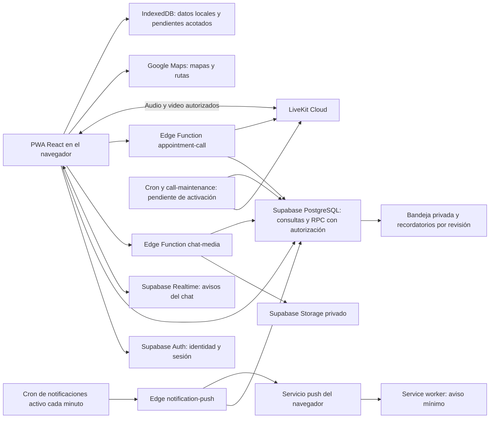

# Funcionamiento de la aplicación y guía de comprobación

Actualizado: **2026-11-18**, zona de referencia **America/Bogota**.

Esta guía explica cómo se conectan los componentes de PWAVeterinaryServices y cómo comprobar el recorrido completo disponible. Está contrastada con el código, las migraciones y las verificaciones registradas en el repositorio. No contiene credenciales ni implica que se haya activado o desplegado un servicio al redactarla.

## 1. Hasta dónde está implementada

La aplicación permite registrar cuentas de dueño o veterinaria, publicar establecimientos tras revisión, configurar servicios y horarios, buscar sedes en Tunja, solicitar/gestionar citas y conversar mediante texto, fotos y voz. **HU01–HU26 tienen implementación. HU27–HU29 incorporan integración de llamada, controles y recuperación; su activación remota y aceptación con dos equipos reales siguen pendientes. HU30–HU33 incorporan permiso/suscripción, avisos y recordatorios remotos, bandeja privada e instalación con ayuda por equipo. El emisor de notificaciones está activo; recepción push e instalación físicas siguen pendientes.**

| Área              | Comportamiento disponible                                                                                                  | Límite actual                                                                                                   |
| ----------------- | -------------------------------------------------------------------------------------------------------------------------- | --------------------------------------------------------------------------------------------------------------- |
| Cuenta y acceso   | Registro por tipo, consentimiento, confirmación, acceso, recuperación, perfil y mascotas del dueño                         | La entrega de correos y el comportamiento en dispositivos físicos requieren aceptación en el entorno utilizado  |
| Establecimientos  | Registro con sedes y mapa de coordenadas, imágenes, revisión administrativa y publicación                                  | Registrarse como Veterinaria no aprueba el negocio automáticamente                                              |
| Oferta            | Servicios, profesionales, recursos, asignaciones, jornadas, bloqueos y colaboradores                                       | Sin la cadena completa de configuración no hay intervalos reservables                                           |
| Descubrimiento    | Mapa/lista Google, búsqueda, filtros, horarios, favoritos y notas                                                          | Los establecimientos provienen de publicaciones aprobadas de esta app; no se importan automáticamente de Google |
| Ubicación y rutas | Tunja como referencia, GPS/origen manual, trazado/ETA y navegación externa                                                 | La ETA no garantiza llegada; no hay navegación giro a giro propia                                               |
| Citas             | Disponibilidad, apartado opcional, solicitud presencial/virtual, decisión, cancelación, reprogramación, agenda e historial | Un apartado no es una solicitud; una solicitud no es una cita confirmada                                        |
| Chat              | Texto persistido, recibos explícitos, recuperación de mensajes, fotos privadas y voz                                       | Sin envío offline automático ni historial remoto de chat guardado en IndexedDB                                  |
| Videollamada      | Autorización por cita, cuenta profesional, sala LiveKit, token limitado y cierre                                           | No se declara operativa hasta completar secretos remotos, mantenimiento y prueba de dos equipos                 |
| PWA               | Instalación, shell offline y actualización confirmada                                                                      | Funcionar offline no permite confirmar citas ni iniciar llamadas sin servidor                                   |

La sincronización general y las HU posteriores siguen pendientes. Los avisos persistidos de citas y mensajes alimentan `/notificaciones`; la entrega push se registra por dispositivo y se distingue de lectura o recepción física. No se envían correos por esta funcionalidad. Ver [HU31–HU33](hu31-hu33.md) para los criterios y las comprobaciones operativas.

## 2. Arquitectura y conexiones

El frontend es una PWA con React, TypeScript y Vite. Se sirve como archivos estáticos. El backend del proyecto está en **Supabase**; los medios de las videollamadas los transporta **LiveKit Cloud**. No es necesario mantener un servidor de video propio para esta arquitectura.



### 2.1. Conexión con Supabase

El cliente único está en [src/lib/supabase.ts](../src/lib/supabase.ts). Lee `VITE_SUPABASE_URL` y `VITE_SUPABASE_ANON_KEY`; esta última admite una clave pública publishable o anon legacy. Si faltan ambas, funciona el shell, pero no los servicios de cuenta/datos. Una configuración parcial o inválida produce un error de configuración.

El navegador utiliza el SDK `@supabase/supabase-js` para:

1. **Auth:** registrar, iniciar sesión, confirmar correo, recuperar acceso y refrescar la sesión. Se usa PKCE para los enlaces de correo.
2. **Base de datos y RPC:** consultar información permitida e invocar operaciones de negocio. Una RPC es una función de PostgreSQL expuesta por la API; por ejemplo, `request_appointment` valida y crea la solicitud dentro de una transacción.
3. **Realtime:** recibir cambios de conversaciones y mensajes. Los eventos provocan una nueva consulta autorizada; no sustituyen las comprobaciones de acceso.
4. **Storage y Edge Functions:** gestionar imágenes del establecimiento y enviar/descargar adjuntos del chat mediante los controles correspondientes.

La sesión persiste mediante el SDK. Para operaciones privadas se valida la cuenta y el servidor comprueba correo confirmado, propietario, rol o permisos. **Ocultar un botón no concede ni revoca permisos:** las políticas de filas (RLS) y las RPC protegen los datos también ante peticiones directas.

El tipo de cuenta se conserva en datos privados del servidor. Los metadatos editables del usuario no autorizan administración ni gestión de otros establecimientos.

| Datos                         | Ubicación principal                                         | Regla importante                                                                         |
| ----------------------------- | ----------------------------------------------------------- | ---------------------------------------------------------------------------------------- |
| Perfil y mascotas             | `profiles`, `pets`                                          | Las mascotas son privadas de su dueño                                                    |
| Solicitud del establecimiento | `establishments`                                            | Conserva el documento privado, estado y revisión                                         |
| Ficha pública                 | `establishment_publications`                                | Solo muestra el snapshot aprobado; una edición pendiente no lo reemplaza                 |
| Servicios y disponibilidad    | `offering_items`, colaboradores y referencias de agenda     | Se gestionan con RPC y revisiones; la disponibilidad se recalcula en servidor            |
| Favoritos/notas               | `establishment_preferences`                                 | Son privados por cuenta; incluyen revisión para detectar conflictos                      |
| Apartados y citas             | `slot_holds`, `offering_appointments`, `appointment_events` | El servidor evita solapes y decide transiciones y vencimientos                           |
| Chat                          | `chat_conversations`, `chat_messages`, `chat_media_uploads` | Acceso por participante o permiso de equipo, con persistencia antes de mostrar «Enviado» |
| Acceso a llamadas             | `appointment_call_hosts`, registros privados de salas       | Relaciona la cuenta profesional con la cita y permite invalidar salas                    |

El proyecto de desarrollo registrado es **`veterinary-services-dev`**, referencia pública **`osoljaiqizmcxxlirrwo`**. El historial documenta **19 migraciones aplicadas/alineadas**, con última comprobación remota el 2026-11-17. La 19 añade incidencias y suscripciones privadas; su versión tiene fecha UTC 2026-11-18. En una base nueva hay que aplicar el conjunto vigente en orden; en desarrollo no se deben repetir ni reiniciar los datos. Consultar [el historial de migraciones](../supabase/migrations/README.md).

### 2.2. Fotos, audios y Realtime

Los mensajes de texto se guardan mediante RPC. Realtime notifica cambios; al reconectar, recuperar foco o usar la recuperación manual, el chat consulta por cursor y une por ID para evitar duplicados. Hay respaldo HTTP cada cinco segundos mientras la conversación está activa. Un fallo de WebSocket no implica por sí solo pérdida del historial persistido.

Los adjuntos siguen este recorrido:

1. Se captura o selecciona el archivo y se muestra una vista previa.
2. Las fotos se comprimen localmente a WebP/JPEG, hasta 1600 px y objetivo máximo de 512 KiB; el original de entrada puede tener hasta 20 MiB.
3. **Guardar archivo pendiente** conserva el blob final y un UUID en IndexedDB, ligados a la cuenta.
4. **Enviar archivo pendiente** invoca `chat-media` con la sesión del usuario.
5. La función valida identidad, relación con el chat, bytes, formato y límites. Guarda el archivo privado y publica el mensaje al finalizar. Los reintentos reutilizan el mismo UUID y contenido.
6. El receptor pulsa **Ver fotografía** o **Cargar nota de voz** para una descarga autenticada. No se entrega una URL pública del adjunto.

El máximo de servidor es 5 MiB por archivo. Las notas de voz admiten hasta 60 segundos; el navegador elige un formato compatible entre WebM/Opus, MP4/AAC y Ogg/Opus. El chat no admite archivos de video: el video previsto pertenece a la videollamada.

El reproductor de voz muestra reproducir/pausar, onda calculada localmente, tiempo y búsqueda por teclado/toque. Solo suena una nota a la vez. Salir pausa el audio y revoca su URL temporal. **Marcar mensajes mostrados como leídos** es una acción explícita: reproducir o descargar no marca automáticamente la lectura.

### 2.3. Conexión con LiveKit Cloud

La clave y el secreto de LiveKit pertenecen exclusivamente al backend. El frontend recibe un **token temporal de participante**, no las credenciales del proyecto. La integración utiliza `livekit-client` en el navegador y `livekit-server-sdk` en las funciones.

Recorrido implementado al entrar:

1. En el detalle de una cita virtual se asigna una **cuenta verificada del equipo** al profesional que atenderá. Crear un registro de «Profesional» en el catálogo no crea una cuenta de acceso.
2. La RPC `authorize_appointment_call` comprueba que la cita sea virtual y confirmada, que participe el dueño solicitante o la cuenta profesional asignada, y que esté dentro de la ventana: **desde 10 minutos antes del inicio hasta 15 minutos después del fin**. La hora válida es la del servidor.
3. Al pulsar **Entrar con audio y video**, el navegador pide permisos de cámara/micrófono e invoca `appointment-call` con el ID de cita y la sesión Supabase.
4. La Edge Function vuelve a autorizar la solicitud, comprueba configuración y mantenimiento, crea la sala privada con máximo dos participantes y revalida la cita después de contactar con LiveKit.
5. Firma un token de hasta 60 segundos, limitado a la sala, identidad, cámara y micrófono. No concede administración, grabación ni compartir pantalla.
6. El navegador conecta con LiveKit Cloud y publica/recibe audio y video. **El video no pasa por PostgreSQL ni se guarda como adjunto en Storage.** No hay grabación automática de la consulta.
7. La pantalla vuelve a comprobar autorización cada diez segundos; salir o fallar libera las pistas. El mantenimiento remoto retira participantes y salas invalidadas o fuera de ventana.

El vencimiento del token limita el ingreso, pero **no corta por sí solo una sesión ya conectada**; por eso se requiere `call-maintenance`. El cierre remoto es asíncrono y depende de que el trabajo programado y LiveKit respondan correctamente. Este comportamiento del token está descrito en la [documentación oficial de tokens y permisos de LiveKit](https://docs.livekit.io/frontends/reference/tokens-grants/).

El modo de ahorro configura video de hasta 640 × 360 a 15 fps, VP8 con objetivo máximo de 500 kbit/s y audio mono de 24 kbit/s, sin simulcast. Son ajustes de publicación, no una garantía de consumo exacto ni una prueba de llamada real.

Fuentes del proyecto: [conexión del cliente](../src/features/calls/livekit.ts), [función de ingreso](../supabase/functions/appointment-call/handler.ts), [firma del token](../supabase/functions/_shared/call-token.ts) y [operación de mantenimiento](../supabase/operations/enable_call_maintenance.sql).

Los controles HU28 permiten elegir cámara/micrófono, silenciar y usar solo audio. HU29 muestra interrupciones sin afirmar continuidad, revalida la misma sala al recuperar conexión y corta tras 35 segundos si no se restablece. Ofrece chat/teléfono e incidencias privadas sin medios ni texto de consulta; un fallo de registro conserva un pendiente por cuenta. Ver [los contratos y recorridos de HU28–HU30](hu28-hu30.md).

### 2.4. Google Maps

Todos los mapas usan Google Maps: exploración, selección de coordenadas y ruta. `VITE_GOOGLE_MAPS_API_KEY` es una clave pública de navegador restringida al origen y a las APIs previstas. El cálculo de ruta ocurre bajo una acción explícita; mostrar el mapa no calcula automáticamente una ruta.

Tunja es la ciudad inicial de búsqueda, no la ubicación de la vivienda. El usuario debe elegir GPS u origen manual para calcular desde su punto de salida. La navegación paso a paso se abre en Google Maps. Sin clave siguen disponibles listado, fichas y navegación externa. Ver [HU17–HU18](hu17-hu18.md).

### 2.5. Permiso y suscripciones push

**Cuenta → Notificaciones del dispositivo** (`/cuenta/notificaciones`) distingue permiso del navegador y suscripción de la cuenta. Solo **Activar notificaciones** solicita permiso. Tras aceptar se registra mediante RPC en `private.push_subscriptions`, con UUID de dispositivo y propietario derivado de Auth. No se exponen endpoints ni claves privadas a otros usuarios.

Desactivar o cerrar sesión confirma primero la desvinculación remota; luego intenta cancelar el endpoint nativo y retira elegibilidad local. Si no se puede confirmar la baja de un vínculo activo/incierto, mantiene la sesión para reintentar con conexión. Los cambios externos de cuenta retiran los marcadores de la cuenta anterior. El SW solo muestra contenido fijo genérico para una cuenta localmente activa y abre `/notificaciones`.

Los eventos de cita/mensaje crean avisos privados únicos y entregas por suscripción en su transacción. Una cita confirmada programa recordatorios según preferencias (15/30/60/120/1440 minutos); cancelar/reprogramar invalida los anteriores. Cron y `notification-push` procesan tareas sin depender de una pestaña abierta, revalidan permisos y registran hasta tres intentos. 404/410 retiran el endpoint vencido; un fallo conserva la bandeja. HTTP 2xx acredita aceptación del servicio, sin garantizar recepción.

**Cuenta → Mis notificaciones** muestra páginas de treinta, fecha, leído/no leído y lectura explícita. Abrir **Ver cita** o **Abrir conversación** vuelve a autorizar y deriva la ruta en servidor. No marca los mensajes del chat. Offline/error no se muestran como ausencia de eventos. La bandeja no tiene copia IndexedDB.

En desarrollo están aplicadas 22 migraciones, `notification-push` desplegada y el job activo cada minuto. Se comprobó Cron exitoso y HTTP 200 con cola vacía, además de 403 sin secreto. Cero dispositivos estaban suscritos, por lo que la entrega física sigue pendiente. Ver [operación y aceptación HU31–HU33](hu31-hu33.md).

## 3. Configuración y ejecución local

### 3.1. Un solo archivo de entorno

Usar **`.env.local` en la raíz**, basado en [.env.example](../.env.example). Si ya existe, completar sus valores; no sobrescribirlo con la plantilla. No crear otro archivo en `supabase/functions`.

| Variable                    | Consumidor     | Uso                                                                                             |
| --------------------------- | -------------- | ----------------------------------------------------------------------------------------------- |
| `VITE_SUPABASE_URL`         | Frontend       | URL del proyecto Supabase                                                                       |
| `VITE_SUPABASE_ANON_KEY`    | Frontend       | Clave pública publishable/anon                                                                  |
| `VITE_GOOGLE_MAPS_API_KEY`  | Frontend       | Clave pública restringida para mapas/rutas                                                      |
| `VITE_GOOGLE_MAPS_MAP_ID`   | Frontend       | ID de mapa; opcional en desarrollo, con fallback `DEMO_MAP_ID`                                  |
| `APP_ALLOWED_ORIGINS`       | Edge Functions | Orígenes permitidos, separados por coma y sin rutas, por ejemplo los puertos locales utilizados |
| `LIVEKIT_URL`               | Edge Functions | URL segura `wss://...livekit.cloud` del proyecto                                                |
| `LIVEKIT_API_KEY`           | Edge Functions | Credencial privada del servidor para LiveKit                                                    |
| `LIVEKIT_API_SECRET`        | Edge Functions | Secreto de firma; nunca se publica                                                              |
| `LIVEKIT_MAINTENANCE_READY` | Edge Functions | `false` durante preparación; `true` solo tras verificar mantenimiento remoto                    |

Las variables `VITE_` se incorporan al frontend al compilar. Nunca poner en ellas secretos, contraseñas o `service_role`. Cambiarlas requiere reiniciar desarrollo o regenerar el build. El runtime remoto de Supabase proporciona sus variables propias de servidor; no copiarlas al cliente.

Las variables privadas del archivo raíz **no se envían automáticamente a Supabase por ejecutar Vite o compilar**. La diferencia entre configuración local y remota está explicada en la [documentación de secretos de Edge Functions](https://supabase.com/docs/guides/functions/secrets). El script valida y selecciona las cinco variables LiveKit/CORS y las cuatro de servidor Web Push cuando se configura su par:

```sh
# Comprobación local de formato. No envía valores ni autentica contra LiveKit.
npm run deploy:secrets -- --check
```

Al redactar esta guía, esa comprobación pasó para el proyecto de desarrollo. Se comprobó presencia de configuración local de Supabase, Google y LiveKit, y que **`LIVEKIT_MAINTENANCE_READY=false` localmente**, sin mostrar valores privados. Esto no verifica los secretos ni el estado actuales de las funciones remotas.

Para Web Push se usan `VITE_WEB_PUSH_PUBLIC_KEY` (pública del frontend), `WEB_PUSH_PRIVATE_KEY`, `WEB_PUSH_SUBJECT` (contacto `mailto:`) y `NOTIFICATION_WORKER_SECRET`. `npm run push:keys` crea/valida el par y genera el secreto de worker que falte sin mostrarlo ni rotarlo. `deploy:secrets` deriva `WEB_PUSH_PUBLIC_KEY` y selecciona las otras tres de servidor, además de LiveKit/CORS. Recompilar al cambiar la pública.

En desarrollo la CLI no tenía sesión para cargar Edge Secrets. Se provisionó Vault desde el mismo archivo raíz mediante la conexión Supabase disponible. El worker recupera configuración con RPC exclusiva de `service_role` y secreto vigente solo cuando no hay variables Edge del emisor; una configuración parcial falla, sin mezclar claves. El job lee su URL y secreto de Vault. No se activó LiveKit ni su mantenimiento. Los nombres, pasos para otro entorno y diagnóstico están en [HU31–HU33](hu31-hu33.md#configuración-un-único-envlocal).

### 3.2. Arranque

Requisitos: Node.js `>=24.15.0 <25`, npm `>=11 <12` y dependencias del lockfile.

```sh
npm ci
npm run dev
```

Vite normalmente muestra desarrollo en `http://localhost:5173`; usar la dirección que informe la terminal. El service worker está desactivado en desarrollo. Para comprobar instalación, offline y actualización:

```sh
npm run build
npm run preview
```

El preview utiliza `http://localhost:4173`; debe estar libre antes de iniciarlo. Una pestaña con una versión anterior puede mostrar **Hay una nueva versión**: pulsar **Actualizar** cuando no haya una operación pendiente.

Para cámara/micrófono y PWA en un teléfono se necesita un **origen HTTPS accesible desde ese teléfono**. Su `localhost` apunta al teléfono, no al computador. El dominio usado debe estar autorizado en Auth, CORS de Edge y restricciones de Google cuando corresponda. Consultar [la guía de HTTPS e instalación](../README.md#probar-en-un-celular-mediante-https).

### 3.3. Qué configurar en Supabase

Para un proyecto nuevo: migraciones vigentes, Email Auth con confirmación, URL de retorno de acceso/recuperación, correo SMTP según el entorno, Storage, publicación Realtime y despliegue de las tres funciones. Los detalles están en [autenticación](autenticacion.md), [migraciones](../supabase/migrations/README.md) y [Edge Functions](../supabase/functions/README.md). Algunos documentos históricos mencionan menos migraciones; el conjunto vigente tiene 19 al corte de esta guía.

Los endpoints de usuario `chat-media` y `appointment-call` tienen `verify_jwt=false` en el gateway, pero validan el bearer con `auth.getUser` y después RPC/RLS. **No son endpoints anónimos.** `call-maintenance` usa autenticación de servidor y no debe invocarse con la clave pública del navegador.

## 4. Cuentas necesarias para comprobar el flujo

Usar cuentas propias o técnicas de prueba, con correos confirmados, en **perfiles o navegadores separados** para no reemplazar la sesión de la otra parte.

| Cuenta                  | Preparación                                                                     | Qué comprueba                                                |
| ----------------------- | ------------------------------------------------------------------------------- | ------------------------------------------------------------ |
| Dueño                   | Registrar como **Dueño de mascota**, confirmar correo y crear una mascota       | Exploración, solicitudes, agenda y conversación como cliente |
| Veterinaria responsable | Registrar como **Veterinaria**, confirmar correo y registrar un establecimiento | Configuración de oferta, decisión de citas y chat de equipo  |
| Administración          | Cuenta con rol administrativo concedido por el mecanismo protegido del proyecto | Revisión y publicación del establecimiento                   |
| Colaborador, opcional   | Veterinaria con invitación aceptada y permisos concretos                        | Accesos limitados y revocación                               |

No existe una contraseña administrativa universal en el código ni un selector «Administrador» en el registro. Utilizar la cuenta administrativa ya autorizada del entorno; el operador del proyecto gestiona la concesión protegida si falta. Elegir Veterinaria no concede ese rol.

Los permisos de equipo son distintos: `services` gestiona catálogo; `schedule` gestiona agenda/configuración de horarios; `read` consulta citas; `messages` accede al chat. El responsable conserva la gestión autorizada del establecimiento. Abrir **Chat desde una cita** exige al colaborador acceso a esa cita **y** `messages`; `messages` solo no permite consultar pacientes.

## 5. Recorrido completo de comprobación

### A. Registro, sesión y mascota

1. Como dueño, abrir `/registro`, elegir el tipo, aceptar privacidad y completar el formulario.
2. Confirmar mediante el correo y entrar por `/acceso`.
3. En **Cuenta → Mis mascotas** (`/perfil#mascotas`), crear una mascota con especie compatible con el servicio que se probará.
4. Recargar y comprobar que los datos se recuperan. En otra cuenta, esa mascota no debe aparecer.
5. Como Veterinaria, comprobar que el perfil presenta opciones del establecimiento y no mezcla el formulario de mascotas.

Resultado esperado: identidad confirmada, menús separados y mascota persistida exclusivamente para su dueño. Para recuperación, probar `/recuperar-acceso` con un correo propio y completar el retorno; una prueba automatizada no demuestra que el correo llegue físicamente.

### B. Registrar y aprobar un establecimiento

1. Como Veterinaria, abrir **Cuenta → Registrar mi establecimiento** (`/oferentes/nuevo`).
2. Completar los cuatro pasos. En Ubicación, seleccionar el punto de cada sede en el mapa, revisar latitud/longitud, dirección y confirmación de coordenadas. Definir zona `America/Bogota` y horario de atención.
3. Enviar a revisión y comprobar su estado en **Mis establecimientos** (`/oferentes`).
4. Como administración, abrir **Revisar solicitudes de oferentes** (`/administracion/oferentes`), revisar contacto, datos y coordenadas, y aprobar. También se pueden probar corrección/rechazo con motivo y posterior reenvío.
5. En una sesión visitante, abrir `/explorar` y encontrar la publicación aprobada.

Resultado esperado: una solicitud pendiente no se publica por sí sola; tras aprobación existe una ficha pública. Una edición posterior pendiente conserva la publicación anterior hasta otra aprobación. La revisión de establecimientos y la confirmación de citas son procesos distintos.

### C. Configurar una oferta que realmente genere horarios

Como responsable, entrar en **Servicios y disponibilidad** (`/oferentes/servicios` o `/oferentes/:id/servicios`) y completar, para una misma sede:

1. **Servicios:** crear uno activo de prueba, por ejemplo consulta presencial de 30 minutos, con especie y modalidad definidas. Crear otro virtual si se probará HU20/HU27.
2. **Profesionales:** crear un profesional activo que admita la modalidad y todas las especies del servicio.
3. **Recursos:** crear un consultorio o recurso de sala virtual activo, compatible con esa modalidad.
4. **Asignaciones:** vincular servicio, profesional y recurso de la misma sede.
5. **Jornadas:** definir días y horas del profesional dentro de los horarios publicados de la sede. Revisar bloqueos, cierres y excepciones.
6. Consultar la previsualización y después la disponibilidad pública de una fecha futura, dentro de los próximos 180 días.

Resultado esperado: aparecen intervalos reservables. **El horario de apertura del negocio no crea por sí solo disponibilidad profesional.** Para decidir citas en la demostración hay que usar un establecimiento propio aprobado o un equipo al que se tenga acceso.

El [seeder DEMO](datos-demostracion.md) ya se cargó en desarrollo y sirve para mapa, búsqueda y disponibilidad: seis establecimientos y siete sedes ficticias de Tunja. Sus cuentas técnicas no tienen contraseña ni permiten entrar para confirmar citas. Sus cierres/bloqueos tienen fechas fijas; elegir otra fecha futura normal cuando corresponda.

### D. Explorar y obtener indicaciones

1. Como dueño o visitante, abrir `/explorar`, quitar filtros anteriores y alternar **Mapa / Lista**.
2. Buscar por establecimiento o servicio y probar categoría, especie, modalidad y apertura. Seleccionar una sede y abrir la ficha.
3. Elegir **Mi ubicación** o un origen manual. La referencia inicial de Tunja no equivale a haber elegido la casa del usuario.
4. Abrir **Cómo llegar**, elegir carro/a pie y pulsar **Calcular ruta en la PWA**, o abrir indicaciones externas de Google Maps.
5. Comprobar que exploración, selección de coordenadas y ruta conservan el proveedor Google. Una denegación GPS permite la alternativa manual.

Resultado esperado: selección de sede coherente y ruta/origen correctos. El cálculo real consulta Google; los tests con SDK controlado no equivalen a esta prueba real.

### E. Solicitar y confirmar una cita presencial

1. Como dueño, abrir `/citas` o acceder desde un servicio de la ficha. La entrada general muestra **Citas pendientes y confirmadas** y la sección **Solicitar una nueva cita**.
2. Elegir establecimiento, sede, servicio, fecha y, opcionalmente, profesional. Seleccionar un intervalo disponible.
3. Se puede apartar cinco minutos, pero es opcional. Elegir la mascota y pulsar **Enviar solicitud de cita**.
4. Comprobar la solicitud en `/citas/solicitudes` y su detalle. Debe quedar solicitada, pendiente de respuesta; ocupa el intervalo mientras esté vigente.
5. Como Veterinaria, abrir **Solicitudes de citas** desde la parte superior de `/oferentes`, o **Solicitudes del establecimiento** (`/oferentes/citas`). Revisar y confirmar o rechazar con motivo cuando corresponda.
6. Como dueño, refrescar o esperar la actualización y revisar estado, instrucciones e historial.

Resultado esperado: ambos ven la misma cita y sus eventos. Un rechazo libera disponibilidad; una solicitud que llega a su inicio sin confirmación vence. **Actualizar establecimientos** refresca las solicitudes de publicación del negocio, no la bandeja de citas.

### F. Cambios, agenda e historial

1. Como dueño, abrir **Mi agenda e historial** (`/citas/agenda`) o el detalle de la solicitud.
2. En **Cambiar o cerrar cita**, probar cancelación con motivo antes del límite permitido.
3. Con otra cita, probar reprogramación a un intervalo disponible. Conserva la mascota y la identidad de la cita, y vuelve a **Solicitada**, por lo que requiere nueva confirmación.
4. Como equipo, usar `/oferentes/agenda` y probar filtros de fecha, modalidad, estado y próximas/historial.
5. Después del fin de una cita confirmada, el personal autorizado puede marcar **Completada** o **No asistió**.

Resultado esperado: cambio y liberación del horario anterior atómicos; si el nuevo horario entra en conflicto, la cita anterior se conserva. Los cambios quedan auditados. Las reglas publicadas de anticipación se copian a la cita y se validan en servidor.

### G. Chat, fotografías y notas de voz

1. Desde una cita visible, pulsar **Chat**, tanto con dueño como con Veterinaria. También hay accesos por **Mis conversaciones** y **Chats del establecimiento**.
2. Comprobar que ambos llegan a la conversación del mismo cliente y sede. Varias citas entre esas partes reutilizan esa conversación; no hay un chat distinto por cada cita.
3. Enviar un texto desde cada parte. Debe aparecer en orden cronológico, con lado, hora y estado adecuados.
4. En la otra sesión, pulsar **Marcar mensajes mostrados como leídos** y comprobar el recibo. Ver el texto no lo marca automáticamente.
5. Usar foto/cámara, revisar la imagen y el peso optimizado, guardar el pendiente y enviarlo. Abrirlo en la otra cuenta con **Ver fotografía**.
6. Usar micrófono, permitir acceso, grabar, detener y escuchar. Guardar y enviar; en la otra cuenta, **Cargar nota de voz**, reproducir/pausar y desplazar la posición sobre la onda. Comprobar que al reproducir otra nota se pausa la anterior.
7. Interrumpir la conexión y recuperarla: el historial debe ponerse al día sin mensajes duplicados. Si un adjunto queda pendiente, reintentar el mismo envío en lugar de crear otra operación.

Resultado esperado: texto, fotos y voz persistidos y privados. El centro puede iniciar el chat desde la cita sin esperar al primer mensaje del cliente. Una cuenta ajena no puede leer la conversación por conocer su URL.

### H. Cita virtual y videollamada

Se puede comprobar la solicitud y confirmación virtual igual que la presencial, usando un servicio **Virtual** compatible. En el detalle se muestran instrucciones y el panel **Videollamada privada**.

Antes de probar medios reales, completar la activación del apartado siguiente. Después:

1. Como responsable o personal autorizado, asignar en el detalle **la cuenta que atenderá como el profesional de esa cita**. Debe ser responsable o colaborador aceptado con `schedule`, con correo confirmado y distinta del dueño solicitante.
2. Confirmar la cita. El dueño y la cuenta profesional asignada deben ver **Ir a la sala de mi cita**.
3. Con dos equipos/cuentas, entrar en `/citas/solicitudes/:id/videollamada` dentro de la ventana autorizada. Pulsar **Entrar con audio y video** y conceder permisos.
4. Comprobar que se ven y se escuchan mutuamente. Si el navegador bloquea el sonido recibido, pulsar **Activar audio recibido**. Ver solo el video propio no prueba comunicación entre dos personas.
5. Probar **Salir de la llamada**: cámara y micrófono deben liberarse. Verificar en el proveedor el cierre correspondiente.
6. Comprobar denegación de una tercera cuenta, de una cita presencial/no confirmada y del acceso fuera de ventana.
7. Como parte de aceptación, comprobar que cancelación, reprogramación o revocación invalidan la sala anterior y que el worker termina retirándola.

Si falta proveedor o mantenimiento, la respuesta prevista es **servicio no habilitado** (`503` cuando se supera la autorización inicial). La aplicación libera los medios y ofrece continuar por chat/teléfono. Esto comprueba el manejo del servicio pendiente, **no una videollamada exitosa**.

### I. Dispositivos, recuperación y permiso push

En una sala autorizada, actualizar dispositivos, cambiar micrófono/cámara, silenciar, apagar cámara o entrar solo por audio; comprobar que la salida detiene también capturas tardías. Interrumpir/restaurar la red y revisar reconexión con nueva autorización en la misma sala, o alternativas/incidencia si vence el intento. Estos pasos de medios reales requieren completar la activación de LiveKit siguiente.

En `/cuenta/notificaciones`, comprobar que abrir la pantalla no pide permiso. Elegir plazo/preferencias, activar explícitamente, revisar vínculo y desactivarlo. Volver a activar y cerrar sesión: otra cuenta requiere su propia activación. Con permiso denegado/API ausente siguen accesibles citas, conversaciones y bandeja.

En `/notificaciones`, comprobar el aviso de solicitud para el establecimiento y el de confirmación para el dueño. Enviar texto/foto/voz y revisar el aviso de la contraparte. Marcar leído, recargar y abrir el recurso autorizado. Cancelar/reprogramar antes del plazo anula el recordatorio anterior. Para entrega física se necesita suscripción real, una cita confirmada futura cuyo recordatorio venza durante la prueba y revisar tanto el resultado del worker como el dispositivo. Ver [recorrido detallado](hu31-hu33.md#comprobación-funcional-con-dos-cuentas).

Para HU33, usar build/preview o HTTPS, instalar mediante acción voluntaria y abrir el icono en Android/computador o Safari de iPhone/iPad. Verificar Inicio, icono y standalone cuando se admita; abrir el shell offline no autoriza operaciones remotas.

## 6. Pasos pendientes para activar LiveKit

Las tres funciones de medios/llamadas están desplegadas y existe una comprobación histórica de solo lectura del par local LiveKit. Su activación, mantenimiento y aceptación siguen pendientes. La cuarta función, `notification-push`, y su job sí están activos; su configuración Vault y comprobación HTTP no habilitan LiveKit ni crean salas.

El operador del proyecto debe completar este orden:

1. Comprobar que la URL Supabase identifica el proyecto de destino y que las tres funciones y migraciones necesarias están presentes.
2. Completar `LIVEKIT_URL`, `LIVEKIT_API_KEY`, `LIVEKIT_API_SECRET` y los orígenes reales en el `.env.local` raíz. Mantener `LIVEKIT_MAINTENANCE_READY=false`.
3. Con Supabase CLI autenticada y permisos sobre ese proyecto, validar y cargar las variables filtradas de backend (LiveKit/CORS y Web Push si está configurado):

   ```sh
   npm run deploy:secrets -- --check
   npm run deploy:secrets
   ```

   El segundo comando **sí modifica secretos remotos**. El script fija CLI 3.1.0 y deriva el destino de `VITE_SUPABASE_URL`; no carga las variables `VITE_`.

4. En Supabase Vault, preparar `call_maintenance_url` con la URL de la función `call-maintenance` del mismo proyecto, y `call_maintenance_auth` con su credencial `service_role`, exclusivamente en servidor. No poner esta credencial en la PWA ni en este documento.
5. Revisar y ejecutar como operador [enable_call_maintenance.sql](../supabase/operations/enable_call_maintenance.sql). Habilita Cron/pg_net y programa el mantenimiento cada 30 segundos; es una operación posterior, no una migración ya aplicada.
6. Comprobar que el worker responde HTTP 200 en las ejecuciones y que procesa cierres. Crear un job no demuestra que el endpoint esté funcionando.
7. Solo entonces cambiar `LIVEKIT_MAINTENANCE_READY=true` en el archivo raíz y volver a ejecutar `npm run deploy:secrets` para reflejarlo en Edge Secrets.
8. Completar la prueba con dos equipos del recorrido H y registrar fecha, entorno y resultados antes de aceptar HU27 como operativa.

No es necesario crear agentes de IA ni un servidor propio de videoconferencia para este flujo entre cliente y profesional. Ver [la guía específica de HU25–HU27](hu25-hu27.md) para mantenimiento, límites y aceptación.

## 7. Qué funciona sin conexión

| Área            | Qué se puede conservar/preparar                                            | Qué exige conexión                                                             |
| --------------- | -------------------------------------------------------------------------- | ------------------------------------------------------------------------------ |
| Shell PWA       | Abrir rutas y recursos precargados tras una primera carga completa         | Primera carga y recursos externos no guardados                                 |
| Perfil/mascotas | Cambios acotados con sesión local vigente y pendientes por cuenta          | Validación y sincronización remotas                                            |
| Favoritos/notas | Lectura/edición guardada, pendientes y resolución explícita de conflictos  | Confirmar la versión en servidor                                               |
| Disponibilidad  | Consultas guardadas marcadas como antiguas y borradores privados           | Apartar o enviar una nueva solicitud; la copia no garantiza cupo               |
| Cambios de cita | Preparar un cambio desde un detalle guardado y guardar el pendiente        | Revalidar y enviar explícitamente; la cita remota sigue vigente mientras tanto |
| Chat            | Historial que siga en memoria y adjuntos propios guardados como pendientes | Recuperar historial remoto, enviar, descargar o confirmar lectura              |
| Videollamada    | Ninguna comunicación de medios offline                                     | Autorizar, entrar y mantener la comunicación                                   |

IndexedDB no sustituye a Supabase ni contiene una copia completa de la aplicación. El esquema v5 conserva datos anteriores y añade marcadores push e incidencias pendientes. Los datos privados se separan por cuenta y se purgan al cerrar sesión según la decisión sobre pendientes. No se envían automáticamente citas, cambios ni adjuntos solo por recuperar la red. Los reportes operativos de incidencias sí tienen replay acotado al entrar/reconectar, con UUID estable. Activar/desactivar push y desvincularlo al salir requieren confirmación remota.

## 8. Comprobar las conexiones y diagnosticar fallos

En DevTools → Network, observar las peticiones sin compartir tokens, cabeceras de autorización ni respuestas privadas. Una respuesta HTTP correcta debe corresponder también a la operación y a los datos esperados.

| Comprobación                      | Señal esperada                                                                  | Si falla, revisar                                                                                    |
| --------------------------------- | ------------------------------------------------------------------------------- | ---------------------------------------------------------------------------------------------------- |
| Acceso y contexto                 | Peticiones de Auth y `current_account_context` coherentes con la cuenta         | Variables públicas, correo confirmado, sesión y tipo elegido                                         |
| Publicación                       | Ficha aprobada en la consulta pública y `/explorar`                             | Proyecto, aprobación, sede publicada y filtros previos                                               |
| Horarios                          | Respuesta de `service_availability` con intervalos futuros                      | Servicio/profesional/recurso/asignación/jornada, sede, zona, bloqueos y ocupaciones                  |
| Solicitud/decisión                | RPC `request_appointment` / `decide_appointment`, estado persistido e historial | Mascota propia, modalidad, permisos, revisión y conflictos de horario                                |
| Chat                              | RPC de historial/envío; WebSocket Realtime o recuperación HTTP                  | Cuenta, relación con conversación y permiso `messages`; refrescar manualmente                        |
| Foto/voz                          | `chat-media` bajo `/functions/v1/`, archivo válido y mensaje publicado          | JWT, CORS, formato, tamaño, cuotas y acceso a Storage                                                |
| Sala                              | `authorize_appointment_call` y después `appointment-call`                       | Confirmación, modalidad, cuenta profesional, ventana, secretos y mantenimiento                       |
| CORS de funciones                 | Origen actual incluido en `APP_ALLOWED_ORIGINS` remoto                          | Coincidencia exacta de protocolo, dominio y puerto; `localhost` y `127.0.0.1` son orígenes distintos |
| Audio/video                       | Permisos concedidos y pistas de ambas partes                                    | HTTPS, dispositivos, bloqueo de reproducción, red y sesión LiveKit                                   |
| Mapa                              | SDK Google y mapas sin errores de autorización                                  | Clave pública, APIs, restricciones del origen, configuración del proyecto y versión activa de la PWA |
| Cambio recién compilado invisible | Aviso de nueva versión y actualización confirmada                               | Service worker anterior; actualizar cuando no haya captura/envío/llamada pendiente                   |

Errores habituales: `401` indica revisar sesión/autenticación; `403` o `42501`, permisos/origen; `40001`, revisión obsoleta; `23P01`, conflicto de ocupación; `23514`, validación de negocio; `CALL_PROVIDER_NOT_CONFIGURED`, activación pendiente de llamadas. El código SQL no siempre coincide con el estado HTTP de la respuesta; leer el mensaje del dominio sin eliminar sus guardas.

Para verificar persistencia, recargar o abrir la otra cuenta y consultar el dato remoto. No basta con que una tarjeta o un aviso visual haya aparecido. En Supabase pueden revisarse Auth, tablas y logs de funciones con acceso de operador. No hace falta desactivar RLS para diagnosticar un fallo.

## 9. Pruebas automatizadas y evidencia disponible

```sh
npm run lint
npm run typecheck
npm test
npm run check:functions
```

Para las pruebas de navegador, dejar libre el puerto 4173; Playwright administra su propio build/preview con datos y servicios controlados:

```sh
npx playwright install chromium

# Recorridos de citas, chat y videollamada preparada.
npx playwright test tests/e2e/appointments.spec.ts tests/e2e/messaging.spec.ts tests/e2e/calls.spec.ts

# Suite completa de navegador.
npm run test:e2e

# Restaurar después un build con el entorno real antes de usar/distribuir el preview.
npm run build
npm run preview
```

Los E2E interceptan Auth/datos y controlan Google y los casos de llamadas. Comprueban interfaz, integración y rechazos, pero **no prueban por sí solos un correo entregado, GPS físico ni una conexión real a LiveKit entre dos equipos**. Los audios/fotos de prueba sí permiten verificar captura, bytes, reproducción y reintentos en el navegador de pruebas.

Evidencia registrada; los recuentos corresponden a ejecuciones concretas:

- Validación conjunta anterior: **217 pruebas de lógica/PostgreSQL en 24 archivos y 101 E2E completos** aprobados.
- Ajuste posterior del reproductor de voz: **21 E2E de mensajería**, incluidos dos nuevos, aprobados; revisión visual a 320/390/1280 px y lint/tipos/build correctos. La suite disponible pasa a **103 E2E**; no se ejecutó completa después de ese ajuste.
- Pruebas SQL/remotas y HTTP de desarrollo documentadas con datos técnicos retirados y rollback según el caso; no equivalen a comprobar de nuevo el estado remoto hoy.
- La creación inicial de esta guía solo validó la configuración local con `--check`, sin repetir la suite de producto ni activar servicios.
- Actualización HU28–HU30: **224 pruebas en 25 archivos y 112 E2E completos con `CI=true` aprobados**, sin fallos ni reintentos en la ejecución final. Migración 19 aplicada y contrato SQL comprobado en desarrollo con rollback, sin alterar datos existentes ni activar LiveKit/envío push. Este registro amplía las ejecuciones históricas anteriores; la aceptación física sigue pendiente.

- Actualización HU31–HU33: **250 pruebas en 29 archivos y 117 E2E completos aprobados**. Se repitieron los cuatro E2E de bandeja tras reforzar escrituras por cuenta y las 66 pruebas del archivo de citas después de cerrar intentos cancelados. Migraciones 20–22 aplicadas y contrato SQL remoto con rollback. Emisor/Cron activos con HTTP 200 en cola vacía y 403 sin token; recepción push e instalación físicas pendientes. Lint, tipos, Deno y build real correctos.

Consultar [docs/verificacion.md](verificacion.md) para fechas, alcance real y limitaciones de cada comprobación.

### Registro sugerido para una demostración

Anotar entorno/origen, fecha y zona, rol utilizado, recorrido A–H, resultado esperado/obtenido y evidencia sin secretos. Para la llamada, registrar dos equipos, recepción de ambos medios y cierre remoto. Usar datos de prueba y evitar capturas con pacientes o credenciales reales.

## 10. Archivos para continuar el proyecto

| Archivo o guía                                                  | Para qué sirve                                              |
| --------------------------------------------------------------- | ----------------------------------------------------------- |
| [AGENTS.md](../AGENTS.md)                                       | Contexto vigente, reglas que deben conservarse y pendientes |
| [README.md](../README.md)                                       | Instalación, hosting, HTTPS y comandos generales            |
| [Tipos de cuenta](tipos-de-cuenta.md)                           | Roles, menús, clasificación y autorización                  |
| [HU07–HU09](hu07-hu09.md)                                       | Configuración de oferta y disponibilidad                    |
| [HU17–HU18](hu17-hu18.md)                                       | Google, rutas, intervalos y apartados                       |
| [HU19–HU21](hu19-hu21.md)                                       | Solicitudes, decisiones y eventos de cita                   |
| [HU22–HU24](hu22-hu24.md)                                       | Cambios, agenda, permisos y chat                            |
| [HU25–HU27](hu25-hu27.md)                                       | Archivos privados y activación pendiente de llamadas        |
| [.env.example](../.env.example)                                 | Nombres de variables sin valores privados                   |
| [scripts/supabase-secrets.mjs](../scripts/supabase-secrets.mjs) | Validación y carga filtrada de configuración de backend     |

Ante diferencias con un pasaje histórico, contrastar el código, las migraciones y la evidencia más reciente. Por ejemplo, `/citas` ya tiene disponibilidad y solicitudes reales; no es el placeholder descrito en documentación inicial.
